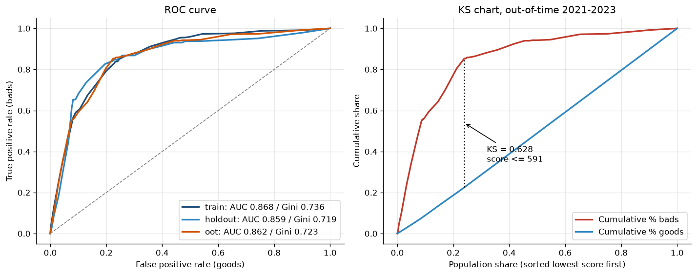
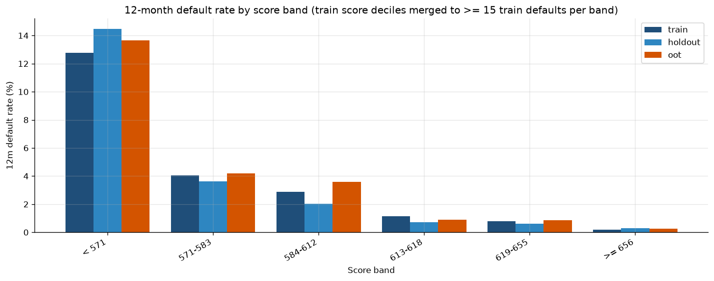
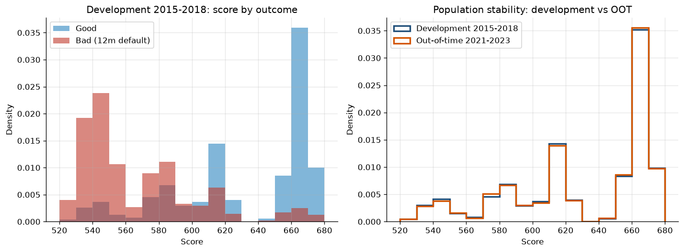

# 12-Month PD Application Scorecard — Model Documentation Summary

**Author:** Ashwani Tripathi  
**Model type:** Points-based scorecard (WOE logistic regression)  
**Target:** 12-month default from origination  
**Status:** Portfolio / demonstration build on a public synthetic dataset, not approved for any credit decision

---

## 1. Purpose

This project builds a transparent, points-based scorecard that ranks newly originated loans by their probability of defaulting within 12 months. It follows the classic bank scorecard workflow: fine and coarse classing, Weight of Evidence (WOE) and Information Value (IV), logistic regression, points scaling, then validation on discrimination, rank ordering and population stability, including an out-of-time sample. Every number below is produced by `scripts/run_scorecard.py` and can be found in `outputs/`.

## 2. Data

| Item | Detail |
|---|---|
| Source | *Credit Risk Dataset — 50k loans, 10 sectors* by **Sergey Nefedov** (Kaggle, v3, MIT License). Archival copy deposited by Jakub Dvořák. Full attribution: [`data/raw/SOURCE_AND_LICENSE.txt`](data/raw/SOURCE_AND_LICENSE.txt) |
| File | `data/raw/loan_portfolio.csv`: 50,000 loans, monthly origination cohorts 2015-01 to 2023-12 |
| Unit | One row per loan, snapshot at origination plus outcome fields |
| Candidate features (origination-time only) | `maturity_months`, `credit_score`, `ead`, `coupon_rate`, `leverage`, `interest_coverage`, `debt_to_equity`, `sector`, `loan_type`, `collateral`, `initial_rating` |
| Excluded as leakage | `pd_annual`, `lgd`, `el`, `unexpected_loss`, `rwa` (outputs of an existing risk model), `survival_months`, `recovery_rate`, `loss_given_default`, `defaulted`, `default_date` (outcomes). These are enforced in code (`LEAKAGE_COLUMNS`) and by a unit test |

### Target definition

`bad_12m = 1` if `default_date` ≤ `origination_date` + 12 calendar months, else 0. Loans that default later, or never, are goods.

All dates are month-starts, so 12 calendar months is 365 days, or 366 when the window crosses 29 February (94 defaults fall exactly on day 366). The calendar-month definition keeps those in the target. A strict `≤ 365 days` cut would push those leap-year cases into the good class purely because of the calendar.

## 3. Sample design and exclusions

| Cohort | Sample | Loans | 12m defaults | 12m DR |
|---|---|---:|---:|---:|
| 2015 | development | 5,585 | 120 | 2.15% |
| 2016 | development | 5,573 | 117 | 2.10% |
| 2017 | development | 5,587 | 122 | 2.18% |
| 2018 | development | 5,505 | 120 | 2.18% |
| 2019 | excluded (COVID shock) | 5,548 | 684 | 12.33% |
| 2020 | excluded (COVID shock) | 5,561 | 320 | 5.75% |
| 2021 | out-of-time | 5,564 | 128 | 2.30% |
| 2022 | out-of-time | 5,571 | 126 | 2.26% |
| 2023 | out-of-time | 5,506 | 128 | 2.32% |

- **Development (2015-2018):** 22,250 loans, split at random 70/30 into train (15,575) and holdout (6,675), stratified on the target (seed 42).
- **Out-of-time (2021-2023):** 16,641 loans, never seen during development.
- **Excluded (2019-2020, 11,109 loans):** for these cohorts the 12-month performance window falls in the COVID-19 shock. Their 12-month default rates (12.3% and 5.8%) are 2.5-6x the roughly 2.2% seen in every other year. That reflects a systemic macro event, not borrower quality at application. Fitting on them would mix the macro shock into the attribute weights and distort the rank ordering for normal conditions. A PD model handles a shock like this through a macro overlay or through stress testing, not in the application score. They also are not used as OOT, because that would test resilience to a crisis rather than the model's normal performance.

## 4. Methodology

1. **Fine classing:** each numeric variable is cut into up to 20 quantile bins on the train set.
2. **Coarse classing (numerics):** adjacent bins are merged until the bad rate is monotonic, each bin holds at least 5% of train accounts and at least 10 train defaults, and there are at most 6 bins. The algorithm tries both directions, increasing and decreasing, and keeps the one with the higher IV.
3. **Grouping (categoricals):** levels are sorted by bad rate. Levels below 5% of accounts or 10 defaults are merged into their closest neighbour by chi-square, and adjacent levels with the smallest chi-square difference are merged down to at most 5 groups.
4. **WOE and IV:** WOE = ln(%good / %bad), with 0.5 smoothing per bin. IV = Σ(%good − %bad)·WOE.
5. **Feature selection:** keep IV > 0.02. Rank by IV, and drop any variable whose WOE has |Pearson r| > 0.6 with a variable already kept.
6. **Model:** logistic regression (statsmodels, unpenalised) of `bad_12m` on WOE values. Any variable with the wrong sign (WOE coefficient ≥ 0) or a p-value > 0.05 is removed one at a time, and the model is refitted.
7. **Scaling:** score = offset + factor·ln(odds good:bad), with **600 points at odds of 50:1 and PDO = 20**. That gives factor = 20/ln 2 = 28.854 and offset = 600 − 28.854·ln 50 = 487.123. The intercept and offset are spread evenly across the characteristics, and attribute points are rounded to whole numbers. A loan's score is the sum of its attribute points. Observed scores run from 522 to 676.
8. **Validation:** AUC, Gini and KS on train, holdout and OOT. Default rates by score band (train score deciles, merged so each band holds at least 15 train defaults) with a monotonicity check. PSI of the score and CSI of the model characteristics and the highest-IV candidates, development (train + holdout) vs OOT. RAG thresholds: green < 0.10, amber 0.10-0.25, red ≥ 0.25.

### IV and selection

| Feature | Type | Bins | IV | Strength | Decision | Reason |
|---|---|---:|---:|---|---|---|
| initial_rating | categorical | 4 | 2.2261 | suspicious | kept | |
| credit_score | numeric | 6 | 1.0513 | suspicious | dropped | abs corr > 0.6 with initial_rating (0.63) |
| coupon_rate | numeric | 6 | 0.8173 | suspicious | dropped | positive coefficient 0.037 (wrong sign) |
| sector | categorical | 5 | 0.0328 | weak | kept | |
| interest_coverage | numeric | 2 | 0.0207 | weak | kept | |
| leverage | numeric | 2 | 0.0202 | weak | dropped | p-value 0.107 > 0.05 |
| ead | numeric | 4 | 0.0106 | unpredictive | dropped | IV <= 0.02 |
| loan_type | categorical | 5 | 0.0065 | unpredictive | dropped | IV <= 0.02 |
| debt_to_equity | numeric | 3 | 0.0054 | unpredictive | dropped | IV <= 0.02 |
| collateral | categorical | 3 | 0.0015 | unpredictive | dropped | IV <= 0.02 |
| maturity_months | numeric | 3 | 0.0011 | unpredictive | dropped | IV <= 0.02 |

IV bands: < 0.02 unpredictive, 0.02-0.1 weak, 0.1-0.3 medium, 0.3-0.5 strong, > 0.5 "suspicious" (worth checking for leakage). The high IVs here are not leakage. `initial_rating` is an origination-time agency or internal grade, and `credit_score` and `coupon_rate` are largely priced off it. Within a rating grade, the default rate does not rise as credit score falls, which suggests the generator drives defaults through rating (inferred). Leaving credit score out loses nothing: added on top of rating, its p-value is 0.45.

### Final model (train)

| Term | Coefficient | Std. error | z | p-value |
|---|---:|---:|---:|---:|
| const | -3.8220 | 0.0739 | -51.73 | 0.00e+00 |
| initial_rating | -1.0048 | 0.0471 | -21.34 | 4.36e-101 |
| sector | -0.9802 | 0.3257 | -3.01 | 2.62e-03 |
| interest_coverage | -1.0399 | 0.3746 | -2.78 | 5.50e-03 |

All coefficients have the expected sign: negative on WOE, so higher WOE means lower risk. WOE correlations among the final three are all below 0.02 (`outputs/woe_correlation_final.csv`).

### Scorecard

| Characteristic | Attribute (bin) | Train n | Train 12m DR | WOE | Points |
|---|---|---:|---:|---:|---:|
| initial_rating | AAA, AA, A, BBB | 8,351 | 0.20% | 2.354 | 267 |
| initial_rating | BB | 3,465 | 1.15% | 0.626 | 217 |
| initial_rating | B | 2,347 | 3.88% | -0.606 | 182 |
| initial_rating | CCC | 1,412 | 13.24% | -1.934 | 143 |
| sector | Consumer, Industrials | 3,150 | 1.59% | 0.307 | 208 |
| sector | Telecom, Real_Estate, Financials | 4,598 | 2.00% | 0.076 | 201 |
| sector | Healthcare, Technology | 3,103 | 2.26% | -0.048 | 198 |
| sector | Energy, Retail | 3,164 | 2.50% | -0.152 | 195 |
| sector | Utilities | 1,560 | 2.82% | -0.282 | 191 |
| interest_coverage | <= 1.75 | 1,575 | 3.11% | -0.386 | 188 |
| interest_coverage | > 1.75 | 14,000 | 2.04% | 0.054 | 201 |

Investment-grade ratings (AAA to BBB) are pooled because together they hold only 17 train defaults; AAA, AA and A have 3 between them. Full bin tables for every candidate are in `outputs/woe_bins.csv`.

## 5. Results

### Discrimination (integer scorecard score)

| Sample | Loans | 12m defaults | 12m DR | Mean model PD | AUC | Gini | KS |
|---|---:|---:|---:|---:|---:|---:|---:|
| train | 15,575 | 335 | 2.15% | 2.15% | 0.868 | 0.736 | 0.605 |
| holdout | 6,675 | 144 | 2.16% | 2.09% | 0.859 | 0.719 | 0.631 |
| oot | 16,641 | 382 | 2.30% | 2.09% | 0.862 | 0.723 | 0.628 |

Gini holds from development to OOT (0.736 → 0.723). Mean predicted PD (2.09%) runs slightly below the OOT observed rate (2.30%), so the model under-predicts by about 0.2 percentage points in level. This is a ranking model, and calibration to a long-run PD is a separate step (see Limitations).



### Rank ordering by score band

| Score band | Train n / bads / DR | Holdout n / bads / DR | OOT n / bads / DR |
|---|---:|---:|---:|
| < 571 | 1,527 / 195 / 12.77% | 649 / 94 / 14.48% | 1,559 / 213 / 13.66% |
| 571-583 | 1,141 / 46 / 4.03% | 469 / 17 / 3.62% | 1,261 / 53 / 4.20% |
| 584-612 | 1,712 / 49 / 2.86% | 688 / 14 / 2.03% | 1,778 / 64 / 3.60% |
| 613-618 | 1,326 / 15 / 1.13% | 559 / 4 / 0.72% | 1,355 / 12 / 0.89% |
| 619-655 | 1,912 / 15 / 0.78% | 836 / 5 / 0.60% | 2,093 / 18 / 0.86% |
| >= 656 | 7,957 / 15 / 0.19% | 3,474 / 10 / 0.29% | 8,595 / 22 / 0.26% |

Default rates fall monotonically as the score rises in **all three samples, with 0 reversals** (`outputs/score_band_monotonicity.csv`). The bands started as train score deciles. The top four deciles, which together hold about half the book and 1-6 train defaults each, were merged into one band (≥ 656) so that every band has at least 15 train defaults. At full decile granularity there are 1, 2 and 2 reversals in train, holdout and OOT, all among those top bands with sub-1% default rates and a handful of defaults (`outputs/score_decile_default_rates_unmerged.csv`).



### Stability: development (2015-2018) vs OOT (2021-2023)

| Variable | Metric | Value | RAG | In model |
|---|---|---:|---|---|
| score | PSI | 0.0005 | green | yes |
| initial_rating | CSI | 0.0004 | green | yes |
| sector | CSI | 0.0001 | green | yes |
| interest_coverage | CSI | 0.0000 | green | yes |
| credit_score | CSI | 0.0005 | green | no |
| coupon_rate | CSI | 1.0559 | red | no |

The score and every model characteristic are green. `coupon_rate` is red because absolute coupons track the rate environment: the median coupon is about 3.16% in 2015-2019, 1.64% in 2021 and 4.74% in 2023. This shows why it would be a poor scorecard characteristic even if it had passed the sign check; a spread over a reference rate would be the stable alternative.



### Challenger check: is anything beyond rating adding value?

| Sample | Final scorecard Gini | `initial_rating` only Gini |
|---|---:|---:|
| train | 0.736 | 0.716 |
| holdout | 0.719 | 0.726 |
| oot | 0.723 | 0.723 |

(Both computed on model PD, `outputs/benchmark_rating_only.csv`.) `sector` and `interest_coverage` meet the selection rules on train (IV > 0.02, p < 0.05), but their bin risk ordering does not repeat out of sample (`outputs/attribute_backtest.csv`). For example, the lowest-risk sector group in train (1.59%) is the highest-risk group in holdout (2.55%), and the low-coverage bin (≤ 1.75) defaults *less* than the rest in both holdout and OOT. The scorecard's out-of-sample power comes entirely from `initial_rating`. In a production review these two characteristics would be challenged and most likely removed, leaving a rating-driven card, or replaced with better-engineered financial ratios.

## 6. Limitations and model risk

- **Synthetic data.** The dataset is simulated. Its very low drift (score PSI 0.0005) and the dominance of rating are features of the generator, not something a real book would show. Results demonstrate the method and say nothing about real-world performance.
- **Rating dependence.** About 98% of the train IV sits in `initial_rating`, `credit_score` and `coupon_rate`, which overlap heavily. The score is close to a re-expression of the rating grade, so it has only 36 distinct values, and over half the book sits in the top band.
- **Weak characteristics overfit.** `sector` and `interest_coverage` pass the in-sample rules but do not validate (see the challenger check). The IV > 0.02 and p < 0.05 rules alone are not enough on roughly 335 train defaults.
- **Low-default segment.** Investment grade has very few defaults (17 in train), so its attributes are pooled and its PD is estimated imprecisely.
- **Calibration.** The model is fitted on 2015-2018 default rates (about 2.15%) and is not calibrated to a through-the-cycle PD. The OOT observed rate is 2.30% against a mean predicted 2.09%. Any regulatory or IFRS 9 use would need calibration, a margin of conservatism and a macro overlay.
- **COVID cohorts excluded.** The model has not been tested under stress. Performance in a 2019-2020 type shock is unknown, and those cohorts would be the natural sample for a stress back-test.
- **Single-split holdout.** Holdout metrics come from one random split. Gini differences of around ±0.02 between train and holdout fall within sampling noise for about 144 holdout defaults.
- **No reject inference.** The data contains booked loans only.

## 7. How to run

```bash
# with uv
uv venv && source .venv/bin/activate
uv pip install -e ".[dev]"

# or with pip
python -m venv .venv && source .venv/bin/activate
pip install -e ".[dev]"

# build + validate (writes outputs/*.csv and outputs/charts/*.png)
python scripts/run_scorecard.py        # or: run-scorecard
pytest -q
```

The run takes about 10 seconds and is deterministic (seed 42).

## 8. Repository layout

```
src/scorecard/
  data.py         load, 12m target, cohort splits, leakage list
  binning.py      fine/coarse classing, monotonic merging, categorical grouping, WOE/IV
  model.py        IV/correlation selection, WOE logistic regression + sign/p-value checks, points scaling, scorecard
  validation.py   AUC/Gini, KS, PSI/CSI, traffic lights, score bands, monotonicity
  plots.py        score distribution, ROC/KS, band default-rate charts
  pipeline.py     end-to-end run
scripts/run_scorecard.py
tests/test_scorecard.py   leakage, target window, points monotonicity, scaling, PSI
data/raw/                 loan_portfolio.csv + SOURCE_AND_LICENSE.txt
outputs/                  CSV results and charts/ (scored_loans.csv is git-ignored)
```

Output files: `cohort_default_rates.csv`, `iv_table.csv`, `woe_bins.csv`, `feature_selection.csv`, `model_coefficients.csv`, `woe_correlation_final.csv`, `scorecard.csv`, `discrimination.csv`, `benchmark_rating_only.csv`, `attribute_backtest.csv`, `score_band_default_rates.csv`, `score_band_monotonicity.csv`, `score_decile_default_rates_unmerged.csv`, `stability_psi_csi.csv`, `psi_score_detail.csv`, `csi_feature_detail.csv`, `summary.json`, `scored_loans.csv`.

## 9. Data attribution and licence

The data is by Sergey Nefedov, *Credit Risk Dataset — 50k loans, 10 sectors* (https://www.kaggle.com/datasets/sergionefedov/credit-risk-dataset-50k-loans-10-sectors), released under the MIT License and used unmodified. See `data/raw/SOURCE_AND_LICENSE.txt`. The code in this repository is © Ashwani Tripathi, MIT License.
